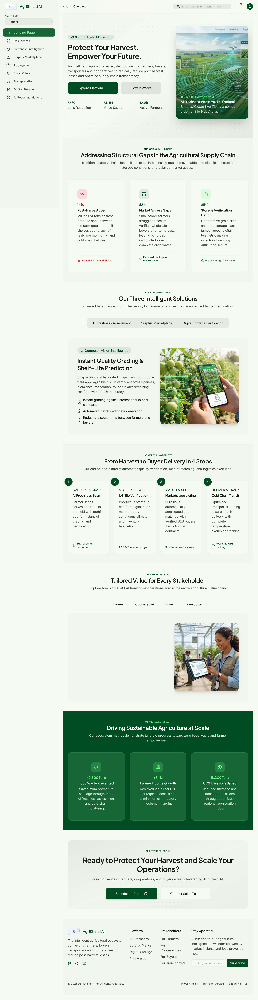
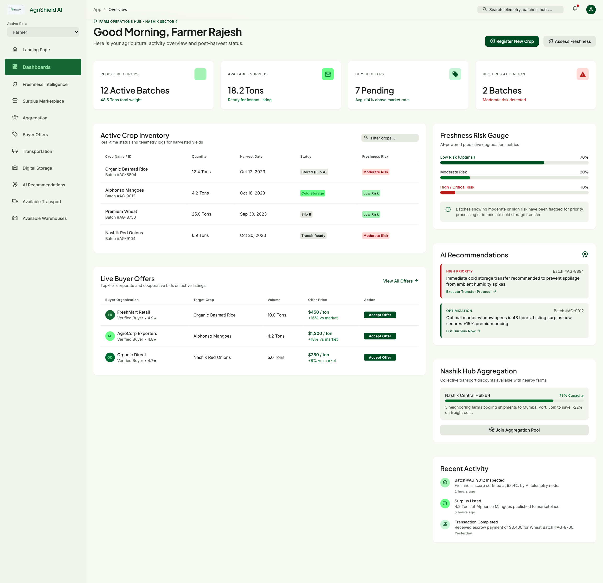
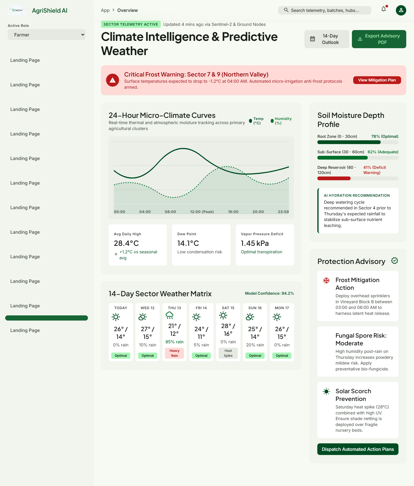
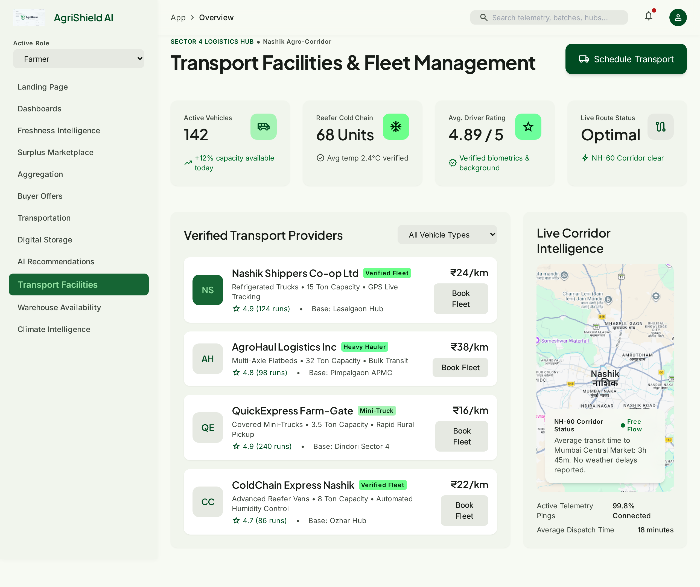
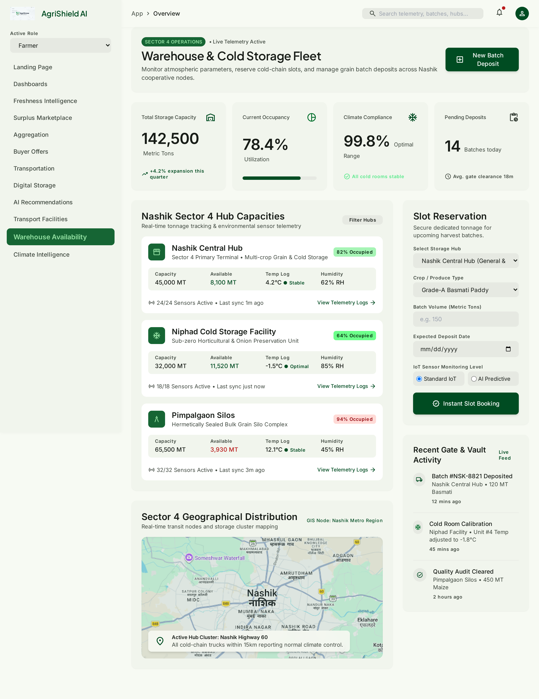
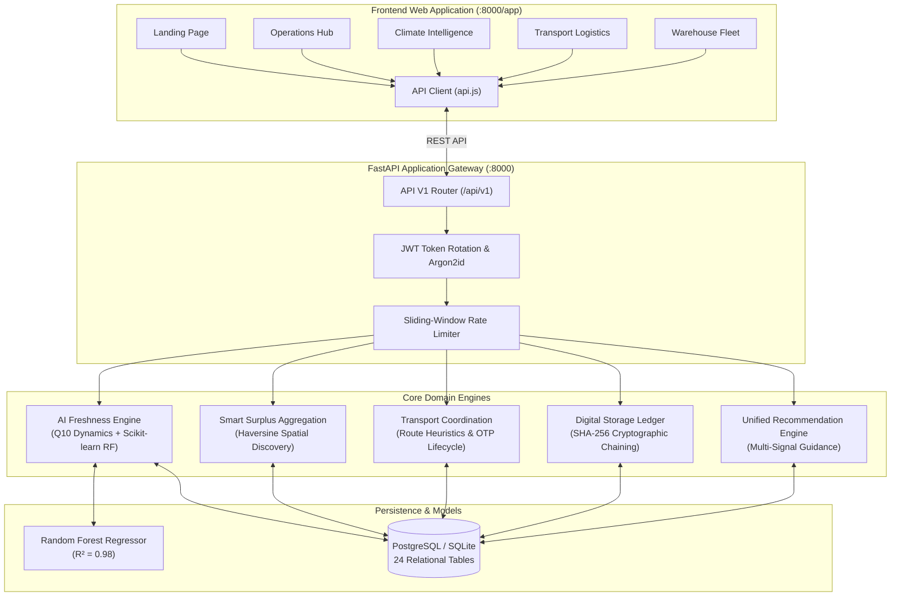

<div align="center">

# 🌾 AgriShield AI
### Next-Gen Agricultural Intelligence Platform to Prevent Post-Harvest Losses

[](https://www.python.org/)
[](https://fastapi.tiangolo.com/)
[](https://www.sqlalchemy.org/)
[](https://scikit-learn.org/)
[](https://tailwindcss.com/)
[](https://pytest.org/)
[](LICENSE)
[]()

<p align="center">
  <b>A modular, fault-tolerant platform empowering smallholder farmers, buyers, transporters, and cooperative societies across rural India.</b><br>
  Combines <b>biochemical degradation forecasting ($Q_{10}$)</b>, <b>geospatial surplus pooling</b>, <b>cold-chain logistics routing</b>, and <b>SHA-256 tamper-evident grain warehousing</b>.
</p>

[🚀 Quick Start](#-quick-start) •
[🖥️ Web Dashboard](#%EF%B8%8F-interactive-web-dashboard) •
[🧠 Core Intelligence Engines](#-core-intelligence-engines) •
[🔌 API Reference](#-api-quick-reference) •
[📚 Documentation Hub](#-technical-documentation)

---

</div>

## 📑 Table of Contents

- [Overview](#-overview)
- [Interactive Web Dashboard](#%EF%B8%8F-interactive-web-dashboard)
- [System Architecture](#%EF%B8%8F-system-architecture)
- [Core Intelligence Engines](#-core-intelligence-engines)
- [Technology Stack](#-technology-stack)
- [Dependencies & Installation Profiles](#-dependencies--installation-profiles)
- [Quick Start](#-quick-start)
- [Testing & Quality Assurance](#-automated-testing)
- [Docker Deployment](#-docker-multi-container-deployment)
- [Demo Credentials](#-demonstration-credentials)
- [Project Directory Layout](#-directory-layout)
- [Technical Documentation Hub](#-technical-documentation)

---

## 💡 Overview

Post-harvest agricultural loss claims **$14\text{--}22\%$** of fresh fruits and vegetables annually across emerging economies due to lack of real-time temperature tracking, unventilated transport, and fragmented market access.

**AgriShield AI** addresses these structural gaps through an end-to-end software platform:
1. **Biological Degradation Forecasting:** Predicts exact remaining hours of safe shelf life using dynamic temperature and vapor pressure deficit models.
2. **Smart Surplus Aggregation:** Eliminates sub-truckload transport penalties by grouping neighboring farms into bulk lots with atomic concurrency locks.
3. **Verified Transportation:** Instant rural haulage quotation via Haversine road heuristics and delivery settlement using 6-digit cryptographic OTPs.
4. **Digital Storage Receipts:** Cryptographically verified warehouse ledgers utilizing SHA-256 block chaining to eliminate fraudulent paper receipts.

---

## 🖥️ Interactive Web Dashboard

The application features a modern web dashboard built with the **Stitch Design System** (`DESIGN.md`), Tailwind CSS, Google Fonts (`Plus Jakarta Sans` & `Inter`), and Material Symbols Outlined.

| Page | View | Primary Features |
| :--- | :---: | :--- |
| **Landing Page**<br>[`frontend/index.html`](frontend/index.html) |  | Platform hero, crisis statistics, core engine overviews, and live status badges. |
| **Operations Hub**<br>[`frontend/dashboard.html`](frontend/dashboard.html) |  | Batch inventory, buyer bids, **Interactive AI Freshness Modal** with $Q_{10}$ calculation, and **Crop Registration Modal**. |
| **Climate Intelligence**<br>[`frontend/climate.html`](frontend/climate.html) |  | 24-hr diurnal temperature/humidity curves, 14-day weather matrix, extreme heat/frost tickers, and soil moisture profiles. |
| **Transport Facilities**<br>[`frontend/transport.html`](frontend/transport.html) |  | Fleet directory, cold-chain monitoring, and **Schedule Transport Modal** with real-time Haversine distance and INR rate estimation. |
| **Warehouse Fleet**<br>[`frontend/storage.html`](frontend/storage.html) |  | Cooperative hub capacities, sensor telemetry logs, and **Batch Deposit Modal** generating SHA-256 cryptographic receipts. |

---

## ⚙️ System Architecture



---

## 🧠 Core Intelligence Engines

<details open>
<summary><b>1. AI Freshness Intelligence Engine (Click to expand)</b></summary>
<br>

The Freshness Intelligence Engine calculates biological deterioration risk ($0\text{--}100$) using crop-specific respiratory kinetics:

$$Q_{10} = 2.0^{\frac{T - T_{\text{optimal}}}{10}}$$

- **Vapor Pressure Deficit (VPD):** Evaluates moisture transpiration stress:
  $$\text{VPD} = e_s(T) \cdot \left(1 - \frac{\text{RH}}{100}\right) \quad [\text{kPa}]$$
- **Machine Learning Integration:** Employs a Scikit-learn Random Forest model ($R^2 = 0.98$, $\text{MAE} = 2.77$) trained on synthetic multi-sensor agricultural telemetry.
- **Graceful Degradation:** If the ML model artifact is unavailable, it automatically falls back to calibrated biochemical rules without service degradation.

</details>

<details>
<summary><b>2. Smart Surplus Aggregation Engine (Click to expand)</b></summary>
<br>

Enables smallholder farmers within a configurable radius ($25\text{ km}$) to pool produce into commercial bulk lots:
- **Haversine Proximity Discovery:** Calculates great-circle spatial distances between farm gates.
- **Atomic Concurrency Protection:** Employs SQLAlchemy `with_for_update` row-level locks on produce listings to guarantee zero double-allocation risk during concurrent offer acceptance.

</details>

<details>
<summary><b>3. Transportation Coordination Engine (Click to expand)</b></summary>
<br>

- **Automated Rural Haulage Quotations:** Calibrates road distances ($1.25\times$ rural detour coefficient) and vehicle base rates (e.g. ₹24/km for reefer cold chain, ₹16/km for mini-trucks) with tonnage surcharges.
- **6-Digit Delivery OTP:** Generates cryptographically secure confirmation tokens verified upon arrival before releasing payment from escrow.

</details>

<details>
<summary><b>4. Digital Storage Verification Ledger (Click to expand)</b></summary>
<br>

- **SHA-256 Hash Chaining:** Every warehouse receipt links the previous block digest, facility ID, batch number, weight, moisture percentage, and inspection timestamp.
- **Fraud Prevention:** Strictly decouples digital record authenticity from physical grain quality grades (Grade A/B/C) to prevent counterfeit warehouse receipts.

</details>

---

## 🛠️ Technology Stack

| Layer | Technology | Key Capabilities |
| :--- | :--- | :--- |
| **Backend Framework** | **FastAPI** | High-performance asynchronous REST API, Pydantic v2 validation, OpenAPI 3.1. |
| **ORM & Database** | **SQLAlchemy 2.0 & PostgreSQL** | Declarative mapping, 24 normalized relational tables, SQLite support for test isolation. |
| **Database Migrations** | **Alembic** | Automated migration generation and version control. |
| **Machine Learning** | **Scikit-learn, NumPy, Joblib** | Random Forest regression model ($R^2 = 0.98$), feature scaling, model persistence. |
| **Security & Cryptography** | **Argon2id & JWT (HS256)** | State-of-the-art password hashing, refresh-token rotation, SHA-256 block hashing. |
| **Frontend UI** | **Tailwind CSS & Material Symbols** | Responsive bento grid, Plus Jakarta Sans & Inter typography, SVG microclimate curves. |
| **Testing Suite** | **Pytest & HTTPX** | 19 automated integration and unit tests passing in <1 second. |
| **Containerization** | **Docker & Docker Compose** | Multi-container setup with health checks, database wait scripts, and production Uvicorn workers. |
| **Documentation Engine** | **Material for MkDocs** | Searchable technical docs site, Mermaid flowcharts, KaTeX math syntax. |

---

## 📦 Dependencies & Installation Profiles

AgriShield AI uses a tiered dependency structure designed for flexible development, containerization, and documentation generation. Detailed breakdowns are provided in [`docs/DEPENDENCIES.md`](docs/DEPENDENCIES.md).

| Installation Profile | Command | Target Use Case |
| :--- | :--- | :--- |
| **Full Project (Recommended)** | `pip install -r requirements.txt` | Complete development stack: FastAPI, SQLAlchemy, Scikit-learn, Pytest, and MkDocs. |
| **Backend Microservice Only** | `pip install -r backend/requirements.txt` | Lean production Docker containers or minimal API servers. |
| **Documentation Site Only** | `pip install mkdocs mkdocs-material pymdown-extensions` | Building or hosting the technical documentation website. |

> [!TIP]
> Run `python -c "import fastapi, sqlalchemy, sklearn; print('All core packages verified!')"` to test your environment.

---

## 🚀 Quick Start

### Step 1: Clone and Set Up Python Environment
```bash
# Clone the repository
git clone https://github.com/gunjalpratik519-commits/AgriHub.git
cd AgriHub

# Create and activate virtual environment
python -m venv venv

# Windows (PowerShell):
.\venv\Scripts\Activate.ps1
# Linux / macOS:
source venv/bin/activate

# Install all project dependencies
pip install -r requirements.txt
```

### Step 2: Configure Environment & Run Migrations
```bash
# Copy template environment file (from project root)
cp .env.example .env

# Apply database migrations directly from root
alembic upgrade head

# Seed realistic demonstration dataset
python backend/scripts/seed_demo_data.py
```

### Step 3: Launch Unified Application Server (Directly from Root)
```bash
# Launch the full platform server directly from root
python run.py
```

*(Alternatively, via Uvicorn CLI:)*
```bash
uvicorn app.main:app --app-dir backend --host 0.0.0.0 --port 8000 --reload
```

🎉 **Access the Platform in Chrome:**
- **Web Application Portal:** [http://localhost:8000/](http://localhost:8000/) *(auto-redirects to `/app/`)*
- **Operations Hub:** [http://localhost:8000/app/dashboard.html](http://localhost:8000/app/dashboard.html)
- **Climate Center:** [http://localhost:8000/app/climate.html](http://localhost:8000/app/climate.html)
- **Transport Fleet:** [http://localhost:8000/app/transport.html](http://localhost:8000/app/transport.html)
- **Warehouse Fleet:** [http://localhost:8000/app/storage.html](http://localhost:8000/app/storage.html)
- **Interactive Swagger Docs:** [http://localhost:8000/docs](http://localhost:8000/docs)
- **System Health Check:** [http://localhost:8000/health](http://localhost:8000/health)

---

## 🧪 Automated Testing

AgriShield AI maintains comprehensive automated test coverage across all domain modules. You can run tests directly from the root repository:

```bash
pytest -v
```

**Test Execution Summary (19/19 Passing):**
```text
tests/test_auth.py::test_user_registration_success PASSED                [  5%]
tests/test_auth.py::test_user_registration_duplicate_email PASSED        [ 10%]
tests/test_auth.py::test_user_login_success PASSED                       [ 15%]
tests/test_auth.py::test_user_login_invalid_password PASSED              [ 21%]
tests/test_auth.py::test_token_refresh_and_rotation PASSED               [ 26%]
tests/test_auth.py::test_auth_me_protected_endpoint PASSED               [ 31%]
tests/test_auth.py::test_protected_endpoint_without_token PASSED         [ 36%]
tests/test_freshness.py::test_assess_freshness_optimal_conditions PASSED [ 42%]
tests/test_freshness.py::test_assess_freshness_severe_heat_stress PASSED [ 47%]
tests/test_freshness.py::test_get_freshness_history PASSED               [ 52%]
tests/test_freshness.py::test_get_crop_guidelines PASSED                 [ 57%]
tests/test_marketplace.py::test_buyer_requirement_lifecycle PASSED       [ 63%]
tests/test_marketplace.py::test_offer_creation_and_authorization PASSED  [ 68%]
tests/test_recommendations.py::test_unified_recommendation_generation PASSED [ 73%]
tests/test_storage_verification.py::test_storage_batch_inspection_and_cryptographic_verification PASSED [ 78%]
tests/test_surplus_and_aggregation.py::test_register_and_query_surplus PASSED [ 84%]
tests/test_surplus_and_aggregation.py::test_nearby_surplus_discovery PASSED [ 89%]
tests/test_surplus_and_aggregation.py::test_aggregation_group_workflow_and_double_allocation_prevention PASSED [ 94%]
tests/test_transport.py::test_transport_flow PASSED                      [100%]

======================== 19 passed, 1 warning in 0.77s ========================
```

---

## 🐳 Docker Multi-Container Deployment

To spin up PostgreSQL and the AgriShield AI API in isolated Docker containers directly from the project root:

```bash
docker-compose up --build -d
```

- PostgreSQL runs on container port `5432` (mapped to host port `5433`).
- The application automatically waits for PostgreSQL readiness, executes migrations, seeds demo data, and serves Uvicorn on port `8000`.

---

## 👥 Demonstration Credentials

Pre-seeded accounts for testing and role-based evaluation:

| Role | Email / Identifier | Password | Default Scope |
| :--- | :--- | :--- | :--- |
| **Farmer** | `farmer.test@agrishield.internal` | `Password123!` | Crop registry, surplus listing, freshness assessment. |
| **Buyer** | `buyer.test@agrishield.internal` | `Password123!` | Requirement creation, bid submission, escrow. |
| **Transporter** | `transporter.test@agrishield.internal` | `Password123!` | Fleet management, haulage bidding, OTP verification. |
| **Cooperative Admin** | `coop.test@agrishield.internal` | `Password123!` | Godown inspection, aggregation pooling, hash ledger. |
| **Platform Admin** | `admin@agrishield.internal` | `AdminPassword123!` | Global audit logs, telemetry configuration, user management. |

---

## 📁 Directory Layout

```text
AgriHub/
│
├── requirements.txt                            # Root dependencies (FastAPI, ML, Tests, Docs)
├── mkdocs.yml                                  # Material for MkDocs configuration
│
├── frontend/                                   # Interactive Stitch Web Application
│   ├── index.html                              # Platform Landing Page & Hero
│   ├── dashboard.html                          # Operations Hub & AI Freshness Modal
│   ├── climate.html                            # Climate Intelligence & 24h Curves
│   ├── transport.html                          # Transport Facilities & Haulage Calculator
│   ├── storage.html                            # Warehouse Fleet & SHA-256 Ledger
│   ├── api.js                                  # Central API Client & Offline Simulator
│   ├── README.md                               # Frontend Documentation & Run Instructions
│   └── design/                                 # Raw Stitch Design System & Screenshots
│       ├── agrishield_ai/DESIGN.md             # Color & Typography Tokens
│       ├── farmer_dashboard/                   # Farmer Hub HTML & screen.png
│       ├── climate_intelligence/               # Climate HTML & screen.png
│       ├── transport_facilities/               # Transport HTML & screen.png
│       └── warehouse_availability/             # Storage HTML & screen.png
│
├── backend/                                    # FastAPI Backend Platform
│   ├── app/
│   │   ├── main.py                             # FastAPI entrypoint, lifespan & static mount
│   │   ├── core/                               # Settings, Security, RBAC, Database
│   │   ├── models/                             # 24 normalized SQLAlchemy ORM models
│   │   ├── schemas/                            # Pydantic v2 validation models
│   │   ├── repositories/                       # Data access layer & atomic row locks
│   │   ├── services/                           # AI Freshness, Surplus, Transport & Ledger
│   │   ├── api/v1/                             # Modular REST API controllers
│   │   └── utils/                              # Haversine distance & cost heuristics
│   ├── migrations/                             # Alembic schema migrations
│   ├── tests/                                  # Pytest suite (19 passing integration tests)
│   ├── scripts/seed_demo_data.py               # Demonstration data seeder script
│   ├── requirements.txt                        # Backend dependencies
│   ├── Dockerfile                              # Containerization buildfile
│   ├── docker-compose.yml                      # PostgreSQL & API stack orchestration
│   └── .env.example                            # Configuration environment template
│
├── ml/                                         # Machine Learning Pipeline
│   ├── models/freshness_model.joblib           # Trained Random Forest Regressor (R² = 0.98)
│   ├── training/train_freshness_model.py       # Model training & serialization pipeline
│   ├── evaluation/evaluate_model.py            # Model cross-validation & metrics
│   └── datasets/freshness_training_data.csv    # Simulated agricultural telemetry dataset
│
├── docs/                                       # Technical Documentation Hub
│   ├── index.md                                # Documentation Home & Site Entry
│   ├── ARCHITECTURE.md                         # Detailed system architecture & concurrency
│   ├── API_DOCUMENTATION.md                    # REST API endpoints, schemas & payloads
│   ├── ML_AND_AGRONOMIC_MODELS.md              # Biochemical math (Q10/VPD) & ML training
│   ├── FRONTEND_GUIDE.md                       # Stitch design tokens & component guide
│   ├── DEPENDENCIES.md                         # Comprehensive dependency matrix & profiles
│   └── DEPLOYMENT_GUIDE.md                     # Production setup, Docker & environment vars
│
├── DEVELOPMENT_STATUS.md                       # Engineering status & verification report
└── .gitignore                                  # Git exclusion rules
```

---

## 📚 Technical Documentation Hub

Explore the comprehensive technical guides in the [`docs/`](docs/) directory:

- 📖 **[Documentation Home (`docs/index.md`)](docs/index.md)** — Guide overview, quick links, and system summary.
- 🏛️ **[System Architecture (`docs/ARCHITECTURE.md`)](docs/ARCHITECTURE.md)** — Architectural diagrams, concurrency models, and table schemas.
- 🔌 **[REST API Reference (`docs/API_DOCUMENTATION.md`)](docs/API_DOCUMENTATION.md)** — Detailed endpoint specifications, payloads, and response schemas.
- 🧪 **[Machine Learning & Agronomic Science (`docs/ML_AND_AGRONOMIC_MODELS.md`)](docs/ML_AND_AGRONOMIC_MODELS.md)** — Biological $Q_{10}$ equations, VPD physics, and Random Forest training.
- 🎨 **[Frontend Design System (`docs/FRONTEND_GUIDE.md`)](docs/FRONTEND_GUIDE.md)** — Stitch design tokens, interactive modal workflows, and responsive layout.
- 📦 **[Dependencies & Environment Guide (`docs/DEPENDENCIES.md`)](docs/DEPENDENCIES.md)** — Detailed package catalog, version matrix, and installation profiles.
- 🚀 **[Deployment & Operations Guide (`docs/DEPLOYMENT_GUIDE.md`)](docs/DEPLOYMENT_GUIDE.md)** — Docker setup, PostgreSQL configuration, and environment variables.

### 🌐 Serving Documentation Locally (MkDocs)

Launch an interactive documentation portal with live search, theme toggling (light/dark), and auto-reload:

```bash
# Start local documentation server
mkdocs serve

# Open in browser:
# http://127.0.0.1:8000 (or http://127.0.0.1:8001 if FastAPI occupies port 8000)
```

To compile a static documentation bundle for production hosting or GitHub Pages:
```bash
mkdocs build
# Compiled files will be created in the site/ directory
```

---

<div align="center">
  <sub>Built with precision for agricultural resilience and smallholder empowerment.</sub>
</div>
