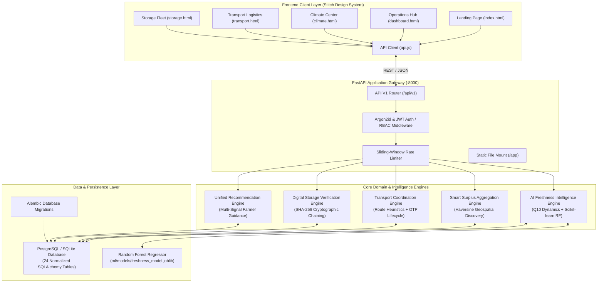

# AgriShield AI — System Architecture & Design Specification

AgriShield AI is an end-to-end, modular, and fault-tolerant agricultural supply chain platform. It integrates biochemical predictive intelligence, geospatial logistics pooling, and cryptographic tamper-evident storage verification.

---

## 1. High-Level Architecture Diagram

---

## 2. Core Subsystems

### 2.1 AI Freshness Intelligence Engine
The Freshness Intelligence Engine computes real-time degradation risk ($0\text{--}100$) for perishable and durable agricultural yields.
- **Hybrid Pipeline:** Combines an agronomic rule base with a trained Scikit-learn Random Forest model ($R^2 = 0.98$).
- **Fail-Safe Mechanism:** If the binary ML model artifact is missing or uncalibrated, execution gracefully falls back to the deterministic $Q_{10}$ rule engine without interrupting user requests.
- **Multi-Factor Inputs:** Harvest timestamp, ambient temperature, relative humidity, storage modality (open-air, traditional shed, ventilated godown, cold-storage, hermetic silo), and transport container conditions.

### 2.2 Smart Surplus Aggregation Engine
Smallholder farmers typically produce sub-truckload volumes (1–5 metric tons) that are expensive to transport individually.
- **Geospatial Clustering:** Computes spatial proximity between farms using the spherical Haversine distance formula with a configurable discovery radius (default: 25 km).
- **Atomic Concurrency:** When a farmer commits a surplus listing to an aggregation pool, SQLAlchemy `with_for_update` row-level locks are acquired to eliminate double-allocation race conditions under concurrent buyer offers.

### 2.3 Transportation Coordination Engine
Manages rural transport fleets ranging from refrigerated cold-chain reefer units to flatbed heavy haulers and mini-trucks.
- **Cost & Transit Estimation:** Automatically factors road detour coefficients ($1.25\times$), vehicle base rates, and weight surcharges to quote accurate costs in Indian Rupees (₹).
- **Delivery Verification:** Employs cryptographically generated 6-digit confirmation One-Time Passwords (OTPs) generated upon dispatch and validated upon delivery before releasing buyer escrow.

### 2.4 Digital Storage Verification Engine
Eliminates physical warehouse receipt fraud and storage disputes in cooperative godowns and grain silos.
- **SHA-256 Cryptographic Hash Chaining:** Every inspection or deposit creates an immutable block linking the previous block's digest, facility ID, batch identifier, weight, moisture percentage, and inspection timestamp.
- **Explicit Separation of Concerns:** Separates the digital authenticity of a warehouse deposit from the physical quality inspection grade (e.g., Grade A/B/C) to prevent falsification of sensor readings.

### 2.5 Unified AI Recommendation Engine
Synthesizes real-time signals across all modules to generate explainable, prioritized recommendations for farmers:
- `URGENT_SALE`: Generated when biological deterioration exceeds critical thresholds.
- `SURPLUS_AGGREGATION`: Triggered when adjacent farmers have compatible crops ready for pooled freight.
- `OFFER_COMPARISON`: Highlights offers with high price margins over APMC mandi spot rates.
- `COOPERATIVE_STORAGE`: Advises moving perishable stock to certified cold storage during seasonal heat waves.

---

## 3. Database Schema Architecture

The relational schema comprises **24 normalized tables** grouped into 6 logical domains:

| Domain | Primary Tables | Responsibility |
| :--- | :--- | :--- |
| **Authentication & Users** | `users`, `farmer_profiles`, `buyer_profiles`, `transporter_profiles`, `cooperative_profiles`, `refresh_tokens` | Argon2id credentials, RBAC roles, contact data, token revocation. |
| **Crops & Telemetry** | `crops`, `crop_guidelines`, `freshness_assessments` | Crop physiological constants, optimal storage envelopes, assessment logs. |
| **Surplus & Aggregation** | `surplus_listings`, `aggregation_groups`, `aggregation_members` | Unsold produce inventory, pool groups, member allocations, atomic locks. |
| **Marketplace** | `buyer_requirements`, `buyer_offers` | Purchase requirements, bids, pricing, escrow status, asset-ownership checks. |
| **Logistics** | `vehicles`, `transport_requests`, `transport_offers`, `shipments` | Fleet registry, haulage bids, GPS telemetry, 6-digit delivery OTPs. |
| **Warehousing & Audit** | `storage_facilities`, `storage_batches`, `storage_inspections`, `verification_records`, `audit_logs`, `notifications` | Facility parameters, tamper-evident hash chaining, system audit logs. |

---

## 4. Security & Concurrency Controls

1. **Authentication:** HMAC-SHA256 JWT tokens with 60-minute access token lifetimes and 7-day refresh tokens. Stale refresh tokens are revoked upon rotation.
2. **Password Hashing:** Argon2id with 64 MB memory cost, time cost 3, and 4 parallel lanes in production; automatically tuned for fast execution during automated testing.
3. **Role-Based Access Control (RBAC):** Strict dependency guards enforcing role hierarchy: `FARMER`, `BUYER`, `TRANSPORTER`, `COOPERATIVE_ADMIN`, and `PLATFORM_ADMIN`.
4. **Rate Limiting:** Sliding-window in-memory rate limiter per IP address to safeguard low-bandwidth rural operations from denial-of-service spikes.

